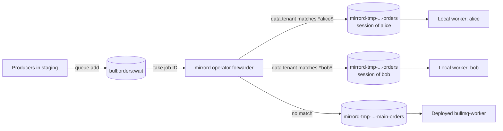

# How to Test BullMQ Workers in Kubernetes with Queue Splitting

This tutorial shows how to run a BullMQ worker on your machine against the real queue in a shared staging cluster. Your local worker gets only the jobs that match your filter. The deployed worker continues to process all other jobs.

You deploy a small sample app: one Redis instance, one Node.js worker, and one producer script. Then you start a mirrord session with a filter on a field of the job data, and you see which jobs go to your machine and which jobs go to the cluster.

mirrord queue splitting needs no changes to the worker code. You do not add an SDK, a wrapper, or a routing check to the worker. The mirrord operator moves the jobs between queues in Redis, and it removes its changes when the session ends.

**Estimated time:** 20 minutes.

## How BullMQ changes the isolation problem

BullMQ keeps each queue in Redis, under keys with the prefix `bull:<queue>:`. A worker takes the next job from the wait list of the queue. When two workers read the same queue, they compete for the jobs. If you start a changed worker on your machine against the staging queue, your worker takes jobs that belong to your colleagues, and the deployed worker loses them.

A private queue does not solve the problem. The producers in staging write to the original queue name, so a private queue gets no jobs unless you also change and redeploy each producer.

mirrord queue splitting keeps the producers and the queue name as they are. The operator takes the jobs from the original queue and puts each job into a different queue, based on the filters of the active sessions. The filter reads the `data` of the job, which is the object that the producer gives to `queue.add()`.

## What you will deploy

All resources go into the namespace `bullmq-demo`:

| Resource | Purpose |
|---|---|
| `redis` Deployment and Service | The Redis backend for BullMQ. One replica, no persistence. |
| `bullmq-app` ConfigMap | The worker script `worker.js` and the producer script `producer.js`. |
| `bullmq-worker` Deployment | The deployed worker. It reads the queue name from the environment variable `BULLMQ_QUEUE`. |
| `bullmq-config` MirrordPropertyList | The Redis connection that the operator uses. |
| `worker-split` MirrordSplitConfig | Tells the operator which workload to split and where its queue name is. |

The pods use the public `node:20-alpine` and `redis:7-alpine` images. You do not build a container image. The worker pod installs the `bullmq` package from npm when it starts, so the cluster needs access to the npm registry.

## Prerequisites

- A Kubernetes cluster for development or staging, version `1.30` or later. Do not use a production cluster.
- `kubectl`, configured for that cluster.
- Node.js and npm on your machine.
- The mirrord CLI, version `3.223.0` or later.
- The mirrord operator, version `3.175.0` or later, with a mirrord for Teams license. Queue splitting is a mirrord for Teams feature.
- BullMQ splitting turned on in the operator Helm chart, with the value `operator.bullmqSplitting`.

To install the operator with BullMQ splitting, run these commands:

```bash
helm repo add metalbear https://metalbear-co.github.io/charts
helm install mirrord-operator metalbear/mirrord-operator \
  --set license.key=<your-license-key> \
  --set operator.bullmqSplitting=true
```

If the operator is already installed, add `--set operator.bullmqSplitting=true` to your `helm upgrade` command.

Make sure that the `MirrordSplitConfig` CRD is in the cluster:

```bash
kubectl get crd mirrordsplitconfigs.queues.mirrord.metalbear.co
```

## Deploy the demo

### 1. Create the namespace and Redis

Save this file as `redis.yaml`:

```yaml
apiVersion: v1
kind: Namespace
metadata:
  name: bullmq-demo
---
apiVersion: apps/v1
kind: Deployment
metadata:
  name: redis
  namespace: bullmq-demo
spec:
  replicas: 1
  selector:
    matchLabels:
      app: redis
  template:
    metadata:
      labels:
        app: redis
    spec:
      containers:
        - name: redis
          image: redis:7-alpine
          args: ["--save", "", "--appendonly", "no"]
          ports:
            - containerPort: 6379
---
apiVersion: v1
kind: Service
metadata:
  name: redis
  namespace: bullmq-demo
spec:
  selector:
    app: redis
  ports:
    - port: 6379
      targetPort: 6379
```

The operator moves jobs with the Redis command `BLMOVE`, which needs Redis 6.2 or later. The `redis:7-alpine` image meets this requirement.

### 2. Create the worker and the producer

The worker prints the queue that it reads when it starts. For each job, it prints the job ID, the job name, and the `tenant` field of the job data. The `tenant` field is the field that the filter uses.

Save this file as `worker.js`:

```javascript
const { Worker } = require('bullmq');

const queueName = process.env.BULLMQ_QUEUE;
const connection = {
  host: process.env.REDIS_HOST,
  port: Number(process.env.REDIS_PORT || 6379),
};

console.log(`worker reads queue "${queueName}"`);

const worker = new Worker(
  queueName,
  async (job) => {
    console.log(
      `job ${job.id} name=${job.name} tenant=${job.data.tenant} order=${job.data.orderId}`,
    );
  },
  { connection },
);

worker.on('failed', (job, err) => {
  console.error(`job ${job ? job.id : '?'} failed: ${err.message}`);
});

async function shutdown() {
  await worker.close();
  process.exit(0);
}

process.on('SIGTERM', shutdown);
process.on('SIGINT', shutdown);
```

The producer adds jobs to the queue `orders`. Each job carries a `tenant` field in its data. The first argument sets the tenant, and the second argument sets the number of jobs.

Save this file as `producer.js`:

```javascript
const { Queue } = require('bullmq');

const [tenant = 'none', count = '3'] = process.argv.slice(2);
const connection = {
  host: process.env.REDIS_HOST,
  port: Number(process.env.REDIS_PORT || 6379),
};

// The producer writes to the original queue name. It does not read
// BULLMQ_QUEUE, because the operator changes that variable during a split.
const queue = new Queue('orders', { connection });

(async () => {
  for (let i = 1; i <= Number(count); i++) {
    const orderId = `${tenant}-${Date.now()}-${i}`;
    await queue.add('process-order', { tenant, orderId });
    console.log(`sent order=${orderId} tenant=${tenant}`);
  }
  await queue.close();
})();
```

Put both scripts into a ConfigMap:

```bash
kubectl apply -f redis.yaml
kubectl -n bullmq-demo create configmap bullmq-app \
  --from-file=worker.js --from-file=producer.js
```

### 3. Deploy the worker

The worker container copies the scripts to `/app`, installs `bullmq`, and starts the worker. The queue name comes from the environment variable `BULLMQ_QUEUE`. The operator changes this variable during a split, so the variable must be in the pod template.

Save this file as `worker.yaml`:

```yaml
apiVersion: apps/v1
kind: Deployment
metadata:
  name: bullmq-worker
  namespace: bullmq-demo
spec:
  replicas: 1
  selector:
    matchLabels:
      app: bullmq-worker
  template:
    metadata:
      labels:
        app: bullmq-worker
    spec:
      containers:
        - name: worker
          image: node:20-alpine
          command: ["sh", "-c"]
          args:
            - >
              mkdir -p /app && cp /src/*.js /app/ && cd /app &&
              npm install --no-save --silent bullmq@5 &&
              exec node worker.js
          env:
            - name: REDIS_HOST
              value: redis.bullmq-demo.svc.cluster.local
            - name: REDIS_PORT
              value: "6379"
            - name: BULLMQ_QUEUE
              value: orders
          volumeMounts:
            - name: app
              mountPath: /src
      volumes:
        - name: app
          configMap:
            name: bullmq-app
```

Apply the file and wait for the rollout:

```bash
kubectl apply -f worker.yaml
kubectl -n bullmq-demo rollout status deploy/bullmq-worker
```

### 4. Create the mirrord resources

The operator connects to Redis to move the jobs. The `MirrordPropertyList` gives the connection. The `MirrordSplitConfig` names the target workload, the queue ID that developers use in `mirrord.json`, and the environment variable that holds the queue name.

Save this file as `split.yaml`:

```yaml
apiVersion: mirrord.metalbear.co/v1
kind: MirrordPropertyList
metadata:
  name: bullmq-config
  namespace: bullmq-demo
spec:
  properties:
    - name: url
      value: redis://redis.bullmq-demo.svc.cluster.local:6379
---
apiVersion: queues.mirrord.metalbear.co/v1
kind: MirrordSplitConfig
metadata:
  name: worker-split
  namespace: bullmq-demo
spec:
  targetRef:
    apiVersion: apps/v1
    kind: Deployment
    name: bullmq-worker
  clientConfigs:
    bullMq: bullmq-config
  queues:
    - id: orders
      kind: bullMq
      appConfig:
        queue:
          - env: BULLMQ_QUEUE
```

Apply the file:

```bash
kubectl apply -f split.yaml
```

## Confirm the baseline

Before you start a session, make sure that the deployed worker gets all jobs.

Open a terminal and follow the worker logs:

```bash
kubectl -n bullmq-demo logs -f deploy/bullmq-worker
```

In a second terminal, send jobs for two tenants. The producer runs in the worker pod, where `bullmq` is already installed:

```bash
kubectl -n bullmq-demo exec deploy/bullmq-worker -c worker -- node /app/producer.js alice 2
kubectl -n bullmq-demo exec deploy/bullmq-worker -c worker -- node /app/producer.js carol 2
```

The deployed worker prints all four jobs. The IDs and order numbers on your cluster are different:

```text
worker reads queue "orders"
job 1 name=process-order tenant=alice order=alice-1764064800000-1
job 2 name=process-order tenant=alice order=alice-1764064800010-2
job 3 name=process-order tenant=carol order=carol-1764064801000-1
job 4 name=process-order tenant=carol order=carol-1764064801010-2
```

## Create sessions and test

### 1. Prepare the local worker

On your machine, create a directory for the local worker. Copy the same `worker.js` into it, and install `bullmq`:

```bash
mkdir bullmq-local && cd bullmq-local
cp ../worker.js .
npm init -y > /dev/null
npm install bullmq@5
```

You can change `worker.js` here. For this tutorial, keep the same code. The local worker does not need a Redis address or a queue name. mirrord gives it the environment of the deployed pod, and the operator sets `BULLMQ_QUEUE` to the queue of your session.

### 2. Write the mirrord configuration

Save this file as `mirrord.json` in `bullmq-local`:

```json
{
  "operator": true,
  "target": {
    "path": "deployment/bullmq-worker/container/worker",
    "namespace": "bullmq-demo"
  },
  "feature": {
    "split_queues": {
      "orders": {
        "queue_type": "BullMQ",
        "message_filter": {
          "tenant": "^alice$"
        }
      }
    }
  }
}
```

The key `orders` is the queue `id` from the `MirrordSplitConfig`. The `message_filter` maps a top-level field of the job data to a regular expression. This filter matches the jobs whose data has `tenant` equal to `alice`.

### 3. Start the session

Start the local worker with mirrord:

```bash
mirrord exec -f mirrord.json -- node worker.js
```

When the first session starts, the operator patches the `bullmq-worker` Deployment, and Kubernetes restarts its pod. Wait until the new pod is ready before you send jobs:

```bash
kubectl -n bullmq-demo rollout status deploy/bullmq-worker
```

The two workers now read different temporary queues. The local worker prints a queue name such as `mirrord-tmp-<random>-orders`. The logs of the new pod show a queue name such as `mirrord-tmp-<random>-main-orders`. Restart the `kubectl logs -f` command, because the old pod is gone.

### 4. Send jobs with and without a match

Send two jobs for `alice` and two jobs for `carol`:

```bash
kubectl -n bullmq-demo exec deploy/bullmq-worker -c worker -- node /app/producer.js alice 2
kubectl -n bullmq-demo exec deploy/bullmq-worker -c worker -- node /app/producer.js carol 2
```

The local worker prints only the jobs for `alice`:

```text
worker reads queue "mirrord-tmp-xkqzpw-orders"
job 1 name=process-order tenant=alice order=alice-1764065000000-1
job 2 name=process-order tenant=alice order=alice-1764065000010-2
```

The deployed worker prints only the jobs for `carol`:

```text
worker reads queue "mirrord-tmp-xkqzpw-main-orders"
job 1 name=process-order tenant=carol order=carol-1764065001000-1
job 2 name=process-order tenant=carol order=carol-1764065001010-2
```

The job IDs start again at 1, because each temporary queue has its own ID counter. The operator copies the job name and the job data without changes.

<!-- TODO: confirm the delay before a BullMQ v5 worker takes a job from a temporary queue. The operator pushes the job ID to the wait list without a BullMQ marker key, so the worker can wait up to its drainDelay (default 5 seconds) before it takes the job. -->

### 5. Add a second developer

Many sessions can split the same queue at the same time. Each session gets its own temporary queue.

Open a new terminal. Make a copy of the local directory, and change the filter to `^bob$` in its `mirrord.json`:

```json
{
  "operator": true,
  "target": {
    "path": "deployment/bullmq-worker/container/worker",
    "namespace": "bullmq-demo"
  },
  "feature": {
    "split_queues": {
      "orders": {
        "queue_type": "BullMQ",
        "message_filter": {
          "tenant": "^bob$"
        }
      }
    }
  }
}
```

Start the second session:

```bash
mirrord exec -f mirrord.json -- node worker.js
```

Send one job for each tenant:

```bash
for t in alice bob carol; do
  kubectl -n bullmq-demo exec deploy/bullmq-worker -c worker -- node /app/producer.js "$t" 1
done
```

The result is:

- The first local worker prints the job for `alice`.
- The second local worker prints the job for `bob`.
- The deployed worker prints the job for `carol`.

The second session does not restart the deployed worker. The operator adds the second filter to the routing that runs already.


Make sure that the filters of different developers do not match the same jobs. When two filters match a job, the operator sends the job to one of the two sessions at random.


### 6. Stop the sessions


When a session ends, the operator deletes the Redis keys of the session queue. Let your local worker process its jobs before you stop it. Jobs that stay in your session queue are deleted.


Press `Ctrl+C` in each terminal that runs `mirrord exec`.

After the last session ends, the operator does these steps:

1. It waits for the deployed worker to finish the jobs in the main temporary queue. This includes jobs that wait, jobs that are delayed or prioritized, and jobs that a live worker holds.
2. It restores the `bullmq-worker` Deployment to read the original queue `orders`. Kubernetes restarts the pod again.
3. It deletes the Redis keys of the main temporary queue.

To limit the wait in step 1, set `spec.drainTimeout` in seconds on the `MirrordSplitConfig`. When the wait ends with unfinished jobs in the main queue, the operator does not delete that queue. It deletes the queue later, when no job in it is unfinished. The `Drained` condition in the status of the `MirrordSplitConfig` names each queue that the operator keeps:

```bash
kubectl -n bullmq-demo get mirrordsplitconfig worker-split -o yaml
```

Send one more job. The restored deployed worker gets it from `orders`:

```bash
kubectl -n bullmq-demo rollout status deploy/bullmq-worker
kubectl -n bullmq-demo exec deploy/bullmq-worker -c worker -- node /app/producer.js alice 1
```

## How it works

When the first session starts, the operator creates a temporary main queue for the deployed worker and patches `BULLMQ_QUEUE` in the workload to point to it. It also creates one temporary queue for each session and gives that name to the local worker. A forwarder in the operator takes each job ID from the wait list of the original queue (`bull:orders:wait`). It reads the `data` field of the job hash as JSON, applies the filters of the sessions, and adds the job to the queue of the matching session. A job that no filter matches goes to the main queue. Producers do not change, and they continue to write to `orders`.



## Behavior and tradeoffs

- **The filter reads only the job data.** `message_filter` matches regular expressions against the top-level fields of the parsed `data` JSON. The filter does not read the job name, the job ID, or the job options. To filter on a job name, put the same value in a data field.
- **Only scalar fields work with `message_filter`.** String, number, and boolean fields match by their text form. A nested object or an array is not an attribute, so a `message_filter` on it never matches. Use `jq_filter` for nested values, for example `".tenant == \"alice\" and .order.priority == \"high\""`. The jq program runs on the full parsed `data` value, and a job matches when the program outputs `true`.
- **Jobs with data that is not JSON go to the deployed worker.** They never match `message_filter` or `jq_filter`.
- **When you set both filters, both must match.** A job goes to your session only when the `message_filter` and the `jq_filter` both match it.
- **Steal is the default.** A matched job goes only to your local worker. With `"queue_mode": "mirror"`, a matched job goes to your local worker, and a copy goes to the deployed worker.
- **The workload restarts twice.** The operator patches the Deployment when the first session starts, and it restores the Deployment after the last session ends.
- **The queue name must come from the pod spec.** The operator reads `BULLMQ_QUEUE` only when the value is in the pod template (`value`, or `valueFrom` with a ConfigMap reference) or comes from a ConfigMap with `envFrom`. A mounted config file is also supported. See the queue splitting overview.
- **The forwarder has tuning values.** With a `queueConfig` property list on the queue entry, you can set `dequeue_timeout` (seconds that the forwarder waits for a new job before it tries again, default `5`) and `jq_time_limit` (milliseconds for each jq evaluation, default `200`). A jq filter that goes over its time limit stops the session.

<!-- TODO: confirm job order. The reference page does not say if the forwarder keeps the FIFO order of the original queue. -->
<!-- TODO: confirm what happens to delayed and prioritized jobs that a producer adds to the original queue while a split runs. The reference page says that the forwarder reads the wait list. -->

## Adapt this to your stack

To use queue splitting with a real BullMQ service, change these items:

1. **The target.** In `targetRef`, set the kind (`Deployment`, `StatefulSet`, or `Rollout`) and the name of your worker workload. In `mirrord.json`, set `target.path` and `target.namespace` to the same workload and container.
2. **The queue name source.** In `appConfig.queue`, name the environment variable that holds the queue name. If the name has a pattern, use `envLike`. If the workload has more than one container, use `containerNames`. Add one entry to `spec.queues` for each queue that the workload reads.
3. **The Redis connection.** In the `MirrordPropertyList`, use `url`, or `host` with `port`. Add `password`, `tls: "true"`, and `db` as necessary. To share one property list with many namespaces, put it in the namespace of the operator.
4. **The filter field.** Pick a top-level field of the job data that tells your jobs apart from other jobs, for example a tenant, a user ID, or a test marker. With mirrord `3.264.0` and operator `3.212.0` or later, you can also use the `filter` field with `any_of` and `all_of` lists.
5. **The temporary queue names.** If your Redis has naming rules, set `spec.tmpNameTemplate`. The template must contain `{{RANDOM}}`.

The worker code does not change. The worker reads its queue name from the environment, as it does in production.

## Cleanup


Stop all mirrord sessions before you delete the resources. If the `MirrordPropertyList` is deleted before the operator finishes the drain, the operator cannot connect to Redis, and you must delete the temporary keys yourself.


Delete the demo namespace. This deletes Redis, the worker, and the mirrord resources:

```bash
kubectl delete namespace bullmq-demo
```

Delete the local directories:

```bash
rm -rf bullmq-local
```

If you used queue splitting on a Redis instance that you keep, look for temporary keys that remain:

```bash
redis-cli --scan --pattern 'bull:mirrord-tmp-*'
```

## Frequently asked questions

### Can I test a BullMQ worker locally against a staging Redis without stealing jobs from other developers?

Yes. Start the local worker with `mirrord exec` and a `split_queues` filter. The operator sends only the jobs that match your filter to your worker. All other jobs go to the deployed worker or to the sessions of other developers.

### Can mirrord filter BullMQ jobs by job name?

No. The filter reads only the `data` field of the job. The job name, the job ID, and the job options are not available to the filter. Add the value to the job data, and filter on that field.

### Do I need to change my BullMQ worker or producer code?

No. The operator changes the `BULLMQ_QUEUE` environment variable of the deployed worker and of your local worker. The producers continue to write to the original queue name. The worker must read its queue name from an environment variable or from a mounted config file.

### What happens to my jobs when I stop mirrord?

The operator deletes your session queue when the session ends. Jobs that stay in it are deleted, so let your worker process them first. Jobs in the main queue of the deployed worker stay until the deployed worker finishes them.

### Can my teammate and I test the same BullMQ queue at the same time?

Yes. Each session gets its own temporary queue, and the operator applies all filters. Use filters that do not overlap. When two filters match a job, the operator sends it to one of the two sessions at random.

### How does my local worker know which session a job belongs to?

When the operator setting `operator.injectSessionKeyHeader` is on, the operator adds a `mirrord-key` field to the `data` object of each job that it sends to your session. The job that the deployed worker gets does not change. A job whose data is not a JSON object goes to your session without the field.

## See also

- [BullMQ queue splitting reference](../../sharing-the-cluster/queue-splitting/bullmq.md)
- [Queue splitting overview](../../sharing-the-cluster/queue-splitting.md)
- [Setting a filter for a mirrord run](../../sharing-the-cluster/queue-splitting.md#setting-a-filter-for-a-mirrord-run)
- [`feature.split_queues` configuration reference](https://metalbear.com/mirrord/docs/config/options#feature-split_queues)
- [Queue splitting status](../../sharing-the-cluster/queue-splitting/status.md)
