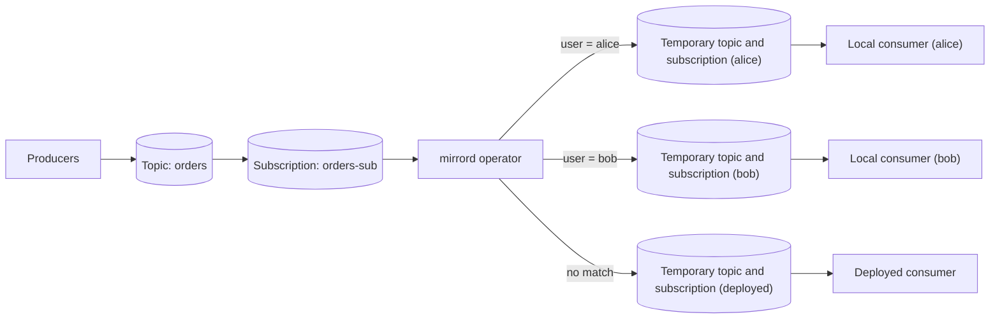

# How to Test GCP Pub/Sub Consumers in Kubernetes with Queue Splitting

A Pub/Sub subscription in a shared staging cluster has one set of consumers. When you run a changed consumer on your machine against that subscription, your consumer and the deployed consumer compete for the same messages. You cannot control which consumer gets which message.

mirrord queue splitting solves this problem. You write a filter on a message attribute, for example `user: alice`. The mirrord operator sends the messages that match your filter to your local consumer, and sends all other messages to the deployed consumer. The consumer code does not change: you do not add an SDK, an interceptor, or a filter check to the consumer.

In this tutorial, you deploy a small Python consumer to Google Kubernetes Engine (GKE), connect it to a real Pub/Sub subscription, and then split the subscription between the deployed consumer and one or two local consumers.

**Sample app:** one Python consumer (about 40 lines), delivered from a ConfigMap. You do not build an image.

**Time:** about 30 minutes.

## How Pub/Sub changes the isolation problem

Pub/Sub is a managed service. You cannot start a second copy of it in the cluster for each developer, and a staging subscription usually gets messages from many producers. Pub/Sub sends each message on a subscription to one subscriber. Thus, if you attach a local subscriber to the staging subscription, you take a random part of the traffic, and the deployed consumer loses that part.

With queue splitting, the operator becomes the only reader of the original subscription. It creates temporary topics and subscriptions, one set for the deployed consumer and one set for each local session. Then it forwards each message to the correct temporary topic, based on the filters of the active sessions.

## What you will deploy

| Resource | Where | Purpose |
|---|---|---|
| Topic `orders` and subscription `orders-sub` | GCP project | The "shared staging" subscription |
| Google service account `order-consumer` | GCP project | Identity of the deployed consumer |
| Google service account `mirrord-operator` | GCP project | Identity of the mirrord operator, with Pub/Sub permissions |
| Namespace `pubsub-demo` | Cluster | Holds the demo |
| ConfigMap `consumer-code` | Cluster | The Python consumer script |
| Deployment `order-consumer` | Cluster | The deployed consumer |
| `MirrordPropertyList` `gcp-pubsub-config` | Cluster | Tells the operator which GCP project to use |
| `MirrordSplitConfig` `order-consumer-split` | Cluster | Tells the operator which subscription to split and where the consumer reads its name |

## Prerequisites

You need these items before you start:

- A GKE cluster with Workload Identity enabled. Queue splitting needs Kubernetes `1.30` or later.
- A GCP project with the Pub/Sub API enabled, and permission to create service accounts and IAM bindings in it.
- `gcloud`, `kubectl`, and `helm` on your machine.
- Python 3.9 or later on your machine.
- mirrord CLI `3.221.0` or later.
- The mirrord operator `3.170.0` or later, installed with Helm, with a Team or Enterprise license.

<!-- TODO: confirm the minimum Python version that the google-cloud-pubsub client supports today. -->

Set these shell variables. The commands in this tutorial use them.

```bash
export PROJECT_ID=my-gcp-project      # your GCP project
export NAMESPACE=pubsub-demo
```

## Deploy the demo

### Step 1: Create the topic and the subscription

```bash
gcloud pubsub topics create orders --project "$PROJECT_ID"
gcloud pubsub subscriptions create orders-sub --topic orders --project "$PROJECT_ID"
```

### Step 2: Give the operator access to Pub/Sub

The operator creates and deletes temporary topics and subscriptions, so it needs Pub/Sub permissions in the project. The `roles/pubsub.editor` role on the project is a good start. This tutorial uses Workload Identity: a Kubernetes service account acts as a Google service account.

Create the Google service account for the operator, and give it the role:

```bash
gcloud iam service-accounts create mirrord-operator --project "$PROJECT_ID"

gcloud projects add-iam-policy-binding "$PROJECT_ID" \
  --member "serviceAccount:mirrord-operator@$PROJECT_ID.iam.gserviceaccount.com" \
  --role roles/pubsub.editor
```

Let the operator's Kubernetes service account (`mirrord-operator` in namespace `mirrord`, the chart defaults) act as the Google service account:

```bash
gcloud iam service-accounts add-iam-policy-binding \
  "mirrord-operator@$PROJECT_ID.iam.gserviceaccount.com" \
  --project "$PROJECT_ID" \
  --role roles/iam.workloadIdentityUser \
  --member "serviceAccount:$PROJECT_ID.svc.id.goog[mirrord/mirrord-operator]"
```

### Step 3: Enable Pub/Sub splitting in the operator

Set two Helm values on your operator release:

- `operator.gcpPubsubSplitting=true` enables Pub/Sub splitting and installs the `MirrordSplitConfig` CRD.
- `sa.gcpSa` adds the `iam.gke.io/gcp-service-account` annotation to the operator's service account.

```bash
helm upgrade mirrord-operator metalbear/mirrord-operator \
  --namespace mirrord \
  --reuse-values \
  --set operator.gcpPubsubSplitting=true \
  --set sa.gcpSa="mirrord-operator@$PROJECT_ID.iam.gserviceaccount.com"

kubectl rollout restart deployment/mirrord-operator -n mirrord
```

Make sure that the CRD exists:

```bash
kubectl get crd mirrordsplitconfigs.queues.mirrord.metalbear.co
```


If your cluster does not use Workload Identity, give the operator a service account JSON key instead. Put the key in a Secret, and add a `credentials_json` property that refers to it in the `MirrordPropertyList` of step 6. See [Option B in the reference page](../../sharing-the-cluster/queue-splitting/gcp-pubsub.md#enabling-gcp-pub-sub-splitting-in-your-cluster).


### Step 4: Give the deployed consumer access to Pub/Sub

The deployed consumer reads from its own subscription. During a split, it reads from a temporary subscription with the `mirrord-tmp-` prefix. Thus, its permissions must also cover that prefix. For this demo, give it `roles/pubsub.subscriber` on the project:

```bash
gcloud iam service-accounts create order-consumer --project "$PROJECT_ID"

gcloud projects add-iam-policy-binding "$PROJECT_ID" \
  --member "serviceAccount:order-consumer@$PROJECT_ID.iam.gserviceaccount.com" \
  --role roles/pubsub.subscriber

gcloud iam service-accounts add-iam-policy-binding \
  "order-consumer@$PROJECT_ID.iam.gserviceaccount.com" \
  --project "$PROJECT_ID" \
  --role roles/iam.workloadIdentityUser \
  --member "serviceAccount:$PROJECT_ID.svc.id.goog[$NAMESPACE/order-consumer]"
```

### Step 5: Write the consumer

Save this script as `consumer.py`. It reads the project and the subscription from environment variables, and prints one line for each message. The line shows which consumer got the message, the `user` attribute, and the `order_id` field of the JSON body.

```python
import json
import os
import sys

from google.cloud import pubsub_v1

# The name that this consumer prints in front of each line.
NAME = sys.argv[1] if len(sys.argv) > 1 else "local"

project = os.environ["GCP_PROJECT_ID"]
subscription = os.environ["PUBSUB_SUBSCRIPTION"]

subscriber = pubsub_v1.SubscriberClient()
path = subscriber.subscription_path(project, subscription)


def callback(message):
    user = message.attributes.get("user", "-")
    try:
        order_id = json.loads(message.data).get("order_id")
    except ValueError:
        order_id = None
    print(f"[{NAME}] order_id={order_id} user={user}", flush=True)
    message.ack()


print(f"[{NAME}] reading from {path}", flush=True)
future = subscriber.subscribe(path, callback=callback)
try:
    future.result()
except KeyboardInterrupt:
    future.cancel()
```

Create a ConfigMap from the script:

```bash
kubectl create namespace "$NAMESPACE"
kubectl create configmap consumer-code -n "$NAMESPACE" --from-file=consumer.py
```

### Step 6: Deploy the consumer and the mirrord resources

Save this file as `demo.yaml`. Replace `my-gcp-project` with your project ID in all four places.

```yaml
apiVersion: v1
kind: ServiceAccount
metadata:
  name: order-consumer
  namespace: pubsub-demo
  annotations:
    iam.gke.io/gcp-service-account: order-consumer@my-gcp-project.iam.gserviceaccount.com
---
apiVersion: apps/v1
kind: Deployment
metadata:
  name: order-consumer
  namespace: pubsub-demo
spec:
  replicas: 1
  selector:
    matchLabels:
      app: order-consumer
  template:
    metadata:
      labels:
        app: order-consumer
    spec:
      serviceAccountName: order-consumer
      containers:
        - name: consumer
          image: python:3.12-slim
          command: ["sh", "-c"]
          args:
            - pip install --quiet google-cloud-pubsub && python /app/consumer.py deployed
          env:
            - name: GCP_PROJECT_ID
              value: my-gcp-project
            - name: PUBSUB_SUBSCRIPTION
              value: orders-sub
          volumeMounts:
            - name: code
              mountPath: /app
      volumes:
        - name: code
          configMap:
            name: consumer-code
---
apiVersion: mirrord.metalbear.co/v1
kind: MirrordPropertyList
metadata:
  name: gcp-pubsub-config
  namespace: pubsub-demo
spec:
  properties:
    - name: project_id
      value: my-gcp-project
---
apiVersion: queues.mirrord.metalbear.co/v1
kind: MirrordSplitConfig
metadata:
  name: order-consumer-split
  namespace: pubsub-demo
spec:
  targetRef:
    apiVersion: apps/v1
    kind: Deployment
    name: order-consumer
  clientConfigs:
    googlePubSub: gcp-pubsub-config
  queues:
    - id: orders
      kind: googlePubSub
      appConfig:
        subscription:
          - env: PUBSUB_SUBSCRIPTION
            containerNames:
              - consumer
        projectId:
          - env: GCP_PROJECT_ID
            containerNames:
              - consumer
```

Apply the file, and wait for the pod:

```bash
kubectl apply -f demo.yaml
kubectl rollout status deployment/order-consumer -n "$NAMESPACE"
```

The `MirrordPropertyList` has only `project_id`. Because it has no `credentials_json`, the operator uses Application Default Credentials, which Workload Identity supplies. The `MirrordSplitConfig` tells the operator that the consumer reads the subscription name from `PUBSUB_SUBSCRIPTION` and the project from `GCP_PROJECT_ID`, in container `consumer`. Developers refer to this subscription by the ID `orders`.


The operator can read the environment variables of a consumer only when they are in the pod template (`value`, or `valueFrom` with a ConfigMap reference), or come from a ConfigMap with `envFrom`.


## Confirm the baseline

Open a terminal, and watch the deployed consumer:

```bash
kubectl logs -f deployment/order-consumer -n "$NAMESPACE"
```

In a second terminal, publish three messages. Each message has a JSON body with an `order_id` and, for two of them, a `user` attribute:

```bash
gcloud pubsub topics publish orders --project "$PROJECT_ID" --message '{"order_id": 1}' --attribute user=alice
gcloud pubsub topics publish orders --project "$PROJECT_ID" --message '{"order_id": 2}' --attribute user=bob
gcloud pubsub topics publish orders --project "$PROJECT_ID" --message '{"order_id": 3}'
```

The deployed consumer gets all three messages. Pub/Sub does not guarantee the order of delivery, so the lines can come in a different order:

```text
[deployed] reading from projects/my-gcp-project/subscriptions/orders-sub
[deployed] order_id=1 user=alice
[deployed] order_id=2 user=bob
[deployed] order_id=3 user=-
```

## Create sessions and test

### Step 1: Prepare your machine

Install the Pub/Sub client, and log in with your own Google account. Your local consumer uses these credentials to read its temporary subscription.

```bash
pip install google-cloud-pubsub
gcloud auth application-default login
```

<!-- TODO: confirm which Google identity the local process must use during a split session, and which Pub/Sub permissions it needs on the `mirrord-tmp-` subscriptions. The reference page does not say. -->

### Step 2: Write the mirrord config

Save this file as `mirrord.json`, in the same directory as `consumer.py`:

```json
{
  "operator": true,
  "target": {
    "path": "deployment/order-consumer/container/consumer",
    "namespace": "pubsub-demo"
  },
  "feature": {
    "fs": "local",
    "split_queues": {
      "orders": {
        "queue_type": "GCPPubSub",
        "message_filter": {
          "user": "^alice$"
        }
      }
    }
  }
}
```

The config does these things:

- `target` names the deployed consumer. Your local process gets its environment variables.
- `feature.fs: local` makes your local process read local files. Thus, the Google client finds your own credentials file.
- `split_queues.orders` refers to the queue ID `orders` in the `MirrordSplitConfig`.
- `queue_type: GCPPubSub` is the queue type for Pub/Sub.
- `message_filter` sends to you only the messages that have the attribute `user` with a value that matches the regex `^alice$`.

### Step 3: Start the local consumer


When the first split session starts, the operator patches the subscription variable of the deployed consumer to a temporary subscription. This restarts the pods of the deployed consumer. Do this on a staging cluster, not in production.


Run the consumer with mirrord:

```bash
mirrord exec -f mirrord.json -- python consumer.py
```

The local consumer reads from a temporary subscription, not from `orders-sub`:

```text
[local] reading from projects/my-gcp-project/subscriptions/mirrord-tmp-...
```

The deployed consumer restarts, and it also reads from a temporary subscription. Run `kubectl logs -f` again to follow the new pod.

### Step 4: Send messages with and without the attribute

Publish the same three messages again:

```bash
gcloud pubsub topics publish orders --project "$PROJECT_ID" --message '{"order_id": 4}' --attribute user=alice
gcloud pubsub topics publish orders --project "$PROJECT_ID" --message '{"order_id": 5}' --attribute user=bob
gcloud pubsub topics publish orders --project "$PROJECT_ID" --message '{"order_id": 6}'
```

The local consumer gets only the message for `alice`:

```text
[local] order_id=4 user=alice
```

The deployed consumer gets the other messages:

```text
[deployed] order_id=5 user=bob
[deployed] order_id=6 user=-
```

You can now change `consumer.py` and run it again with the same command. The deployed consumer continues to process all traffic that does not match your filter.

### Step 5: Add a second developer

More than one developer can split the same subscription at the same time. The operator creates one more temporary topic and subscription for each new session, and adds the new filter to the filters that it checks.

Save this file as `mirrord-bob.json`:

```json
{
  "operator": true,
  "target": {
    "path": "deployment/order-consumer/container/consumer",
    "namespace": "pubsub-demo"
  },
  "feature": {
    "fs": "local",
    "split_queues": {
      "orders": {
        "queue_type": "GCPPubSub",
        "message_filter": {
          "user": "^bob$"
        }
      }
    }
  }
}
```

Keep the first session open. In a new terminal, start a second session:

```bash
mirrord exec -f mirrord-bob.json -- python consumer.py bob
```

Publish the three messages again (`order_id` 7, 8, and 9, with `alice`, `bob`, and no attribute). Each consumer gets its part:

```text
[local] order_id=7 user=alice
[bob] order_id=8 user=bob
[deployed] order_id=9 user=-
```


If the filters of two sessions both match a message, the operator sends the message to one of the two sessions at random. Use filters that do not overlap, for example one user name for each developer.


### Step 6: Stop the sessions

Press `Ctrl+C` in each terminal that runs `mirrord exec`.

When the last session ends, the operator puts back the original subscription name in the deployed consumer, so the deployed consumer reads from `orders-sub` again. The pods restart for this change. Before the operator deletes the temporary subscription of the deployed consumer, it reads it, to make sure that no message in it is left unread. If messages are left, the operator keeps the subscription until it is empty. The `spec.drainTimeout` field of the `MirrordSplitConfig` sets a limit, in seconds, for this wait. Without it, the operator waits until all messages are drained.

<!-- TODO: confirm what happens to messages that are still in a local session's temporary subscription when that session ends. The reference page does not say. -->

Publish one more message. The deployed consumer gets it from `orders-sub`:

```text
[deployed] reading from projects/my-gcp-project/subscriptions/orders-sub
[deployed] order_id=10 user=alice
```

## How it works

When the first session starts, the operator creates temporary topics and subscriptions: one set for the deployed consumer and one set for each local consumer. It patches the subscription variable of the deployed consumer to read from its temporary subscription, and gives the local process the name of the local temporary subscription. Then the operator drains the original subscription. For each message, it checks the filters of the active sessions, and publishes the message to the temporary topic of the session that matches. Messages that match no filter go to the temporary topic of the deployed consumer.



## Behavior and tradeoffs

- **Version requirements.** Pub/Sub splitting needs operator `3.170.0` or later and mirrord CLI `3.221.0` or later. The composable `filter` field needs mirrord `3.264.0` and operator `3.212.0` or later. `message_filter` works on all supported versions.
- **Restarts.** The operator patches an environment variable of the deployed consumer when the first session starts and when the last session ends. Each patch restarts the pods.
- **Where the subscription name comes from.** The consumer must read the subscription name from an environment variable or from a file mounted from a ConfigMap or Secret. If the variable holds a longer string, such as a Go CDK URL, use `valuePattern` so the operator replaces only the subscription name.
- **What the filter can match.** `message_filter` and `filter` match message attributes. `jq_filter` runs a jq program on the JSON form of the `PubsubMessage`, so it can read the body after `@base64d`. For Cloud Storage notifications, `jq_filter` can also read the object metadata as `gcsMetadata` (operator `3.214.0` or later).
- **Filters that overlap.** When two sessions match the same message, one session gets it at random.
- **Steal or mirror.** In the default `steal` mode, a matched message goes only to your local consumer. With `queue_mode: mirror`, the deployed consumer also gets a copy.
- **Temporary subscription settings.** Temporary subscriptions copy the settings of the original subscription, including the acknowledgement deadline, message retention, and expiration. To get more time at a breakpoint, set `ack_deadline_seconds` in a `MirrordPropertyList` and refer to it with `queueConfig`.
- **Autoscaled consumers.** If KEDA scales the consumer on the original subscription, KEDA sees no load during a split. Set the Helm value `operator.manageKedaScaledObjects` (operator `3.215.0` or later) so that the triggers follow the temporary subscription.
- **Extra path.** Each message goes through the operator and a temporary topic before it reaches a consumer.

<!-- TODO: confirm how splitting affects Pub/Sub ordering keys and exactly-once delivery subscriptions. The reference page does not say. -->

## Adapt this to your stack

To use queue splitting with a real service, change these items:

1. **Target.** In the `MirrordSplitConfig`, set `targetRef` to your Deployment, StatefulSet, or Argo Rollout. In `mirrord.json`, set `target.path` and `target.namespace` to the same workload and container.
2. **Subscription and project variables.** Set `appConfig.subscription` and `appConfig.projectId` to the variables that your consumer reads. Use `envLike` for a regex on variable names, `volume` for a name in a mounted file, or `valuePattern` for a name inside a URL.
3. **Several subscriptions.** Add one entry under `spec.queues` for each subscription, each with its own `id`. Subscriptions can be in different projects.
4. **Credentials.** Use Workload Identity, or a JSON key in the `MirrordPropertyList`. Put the property list in the operator's namespace to share it across namespaces. If your consumer's IAM permissions name specific subscriptions, extend them to the `mirrord-tmp-` prefix, or change the prefix with `spec.tmpNameTemplate`.
5. **Filter attribute.** Choose an attribute that your producers already set, for example a tenant, a user ID, or a trace value. If your services do not forward message metadata yet, see [Header Propagation](../../sharing-the-cluster/header-propagation.md).
6. **Body filters.** If the value for the filter is only in the body, use `jq_filter`, for example `.data | @base64d | fromjson | .user_id == "test-user"`.

The consumer code does not change. The consumer reads the subscription name from its environment as before, and the operator supplies a different name during the session.

## Cleanup


Stop all sessions before cleanup. If you delete the namespace while a temporary subscription still holds messages, the operator loses its `MirrordPropertyList` and cannot delete the subscription. Then you must delete it yourself.


Make sure that no temporary resources are left:

```bash
gcloud pubsub subscriptions list --project "$PROJECT_ID" --filter="name~mirrord-tmp-" --format="value(name)"
gcloud pubsub topics list --project "$PROJECT_ID" --filter="name~mirrord-tmp-" --format="value(name)"
```

If both lists are empty, delete the demo resources:

```bash
kubectl delete namespace "$NAMESPACE"

gcloud pubsub subscriptions delete orders-sub --project "$PROJECT_ID"
gcloud pubsub topics delete orders --project "$PROJECT_ID"

gcloud projects remove-iam-policy-binding "$PROJECT_ID" \
  --member "serviceAccount:order-consumer@$PROJECT_ID.iam.gserviceaccount.com" \
  --role roles/pubsub.subscriber
gcloud iam service-accounts delete "order-consumer@$PROJECT_ID.iam.gserviceaccount.com" --project "$PROJECT_ID"
```

If you do not need Pub/Sub splitting any more, also remove the operator's access:

```bash
gcloud projects remove-iam-policy-binding "$PROJECT_ID" \
  --member "serviceAccount:mirrord-operator@$PROJECT_ID.iam.gserviceaccount.com" \
  --role roles/pubsub.editor
gcloud iam service-accounts delete "mirrord-operator@$PROJECT_ID.iam.gserviceaccount.com" --project "$PROJECT_ID"

helm upgrade mirrord-operator metalbear/mirrord-operator \
  --namespace mirrord --reuse-values \
  --set operator.gcpPubsubSplitting=false \
  --set sa.gcpSa=null
```

## Frequently asked questions

**Do I need to change my Pub/Sub consumer code to use queue splitting?**

No. The consumer reads its subscription name from an environment variable or a mounted file, as it does now. The operator changes that value for the deployed consumer and for your local process. You do not add a library or a filter check to the consumer.

**Can I test a Pub/Sub consumer locally against a shared staging subscription without taking messages from other developers?**

Yes. Each developer runs `mirrord exec` with a filter on a message attribute or on the body. The operator sends each developer only the messages that match that developer's filter. Messages that match no filter go to the deployed consumer.

**What happens if two developers' filters match the same Pub/Sub message?**

The operator sends the message to one of the two sessions at random. Neither session gets a copy of the other session's message. Use filters that do not overlap, such as a different user name for each developer.

**Can I filter Pub/Sub messages on the message body instead of attributes?**

Yes. Use `jq_filter`. It runs a jq program on the JSON form of the `PubsubMessage`, so decode the body first, for example `.data | @base64d | fromjson | .user_id == "test-user"`. If you also set `message_filter`, a message must match both filters.

**Does mirrord queue splitting work with the Pub/Sub emulator?**

<!-- TODO: confirm whether Pub/Sub splitting supports the Pub/Sub emulator. The reference page does not document it. The operator source reads an `endpoint` property from the MirrordPropertyList and uses anonymous credentials when `credentials_json` is not set, but this is not in the public docs. -->
The Pub/Sub reference page does not document a setup with the emulator. This tutorial uses a real Pub/Sub topic and subscription in a GCP project.

**Why did my deployed consumer restart when I started a mirrord session?**

The operator changes the subscription environment variable of the deployed consumer to point at a temporary subscription. A change to the pod template restarts the pods. The pods restart again when the last session ends and the operator puts back the original value.

## See also

- [Google Cloud Pub/Sub queue splitting reference](../../sharing-the-cluster/queue-splitting/gcp-pubsub.md)
- [Queue splitting overview](../../sharing-the-cluster/queue-splitting.md)
- [Set a filter for a mirrord run](../../sharing-the-cluster/queue-splitting.md#setting-a-filter-for-a-mirrord-run)
- [`feature.split_queues` configuration reference](https://metalbear.com/mirrord/docs/config/options#feature-split_queues)
- [Header Propagation](../../sharing-the-cluster/header-propagation.md)
