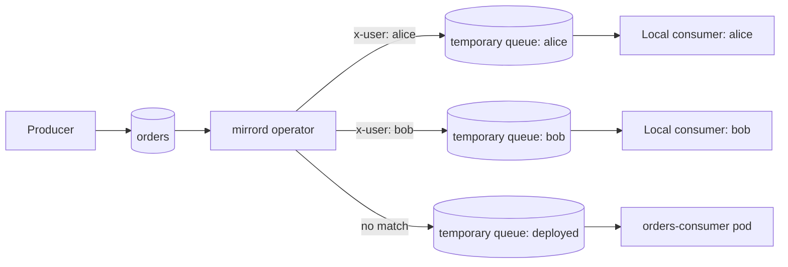

# How to Test RabbitMQ Consumers in Kubernetes with Queue Splitting

This tutorial shows how to run a changed RabbitMQ consumer on your machine against a shared staging queue in Kubernetes. With mirrord queue splitting, your local consumer gets only the messages that match your filter. The deployed consumer keeps all the other messages.

Queue splitting needs no change to the consumer code. You do not add an SDK, a client wrapper, or a routing check to the consumer. The mirrord operator routes the messages, and the consumer reads its queue name from an environment variable, as it does now.

You deploy a small sample app: one RabbitMQ broker, one Python consumer, and a Python script that sends test messages. All the code is in this page. You do not build a container image.

**Estimated time:** 20 minutes.

## How RabbitMQ changes the isolation problem

In RabbitMQ, all the consumers of one queue compete for its messages. The broker gives each message to one consumer only. If you connect a local consumer to the shared `orders` queue, it takes a random part of the messages. The deployed consumer does not get those messages, and other developers lose test messages that they sent.

Queue splitting solves this problem. The operator reads the original queue and sends each message to a temporary queue. Each mirrord session gets its own temporary queue, and the deployed consumer gets one too. Your filter decides which messages go to your temporary queue. Messages that match no filter go to the deployed consumer.

## What you will deploy

All resources go into the namespace `rmq-demo`:

- A `Secret` with the RabbitMQ user name and password.
- A RabbitMQ broker: one replica, no persistent storage, for test use only.
- A `ConfigMap` with two Python scripts: `consumer.py` and `producer.py`.
- The `orders-consumer` Deployment. It runs `consumer.py` from the public `python:3.12-slim` image.
- A `MirrordPropertyList` that tells the operator how to connect to RabbitMQ.
- A `MirrordSplitConfig` that tells the operator which queue the consumer reads, and from which environment variable.

Each message carries an `x-user` header, for example `x-user: alice`. The filters in this tutorial match on this header.

## Prerequisites

Before you start, make sure that you have these items:

1. A Kubernetes cluster, version `1.30` or later. Queue splitting needs this version.
2. `kubectl`, with access to the cluster.
3. Python 3 on your machine, with the `pika` package version `1.5.0` or later: `pip install pika==1.5.0`. Under mirrord, `pika` 1.3.2 does not connect and waits forever.
4. The mirrord CLI, version `3.221.0` or later.
5. The mirrord operator, version `3.170.0` or later, on a mirrord Team or Enterprise plan.
6. RabbitMQ splitting turned on in the operator Helm chart.

To turn on RabbitMQ splitting, set the `operator.rmqSplitting` Helm value. Run this command in the namespace and kubecontext where you installed the Helm release:

```bash
helm repo update
helm upgrade mirrord-operator metalbear/mirrord-operator \
  --reuse-values \
  --set operator.rmqSplitting=true
```

Make sure that the `MirrordSplitConfig` CRD exists:

```bash
kubectl get crd mirrordsplitconfigs.queues.mirrord.metalbear.co
```


The pod of the sample consumer installs `pika` from PyPI when it starts. Your cluster must have outbound internet access. If it does not, build an image with `pika` installed and use that image in the Deployment.


## Deploy the demo

Save this file as `rmq-demo.yaml`:

```yaml
apiVersion: v1
kind: Namespace
metadata:
  name: rmq-demo
---
apiVersion: v1
kind: Secret
metadata:
  name: rabbitmq-credentials
  namespace: rmq-demo
stringData:
  username: demo
  password: demo-password
---
apiVersion: apps/v1
kind: Deployment
metadata:
  name: rabbitmq
  namespace: rmq-demo
spec:
  replicas: 1
  selector:
    matchLabels:
      app: rabbitmq
  template:
    metadata:
      labels:
        app: rabbitmq
    spec:
      containers:
        - name: rabbitmq
          image: rabbitmq:3.13-management-alpine
          ports:
            - containerPort: 5672
              name: amqp
          env:
            - name: RABBITMQ_DEFAULT_USER
              valueFrom:
                secretKeyRef:
                  name: rabbitmq-credentials
                  key: username
            - name: RABBITMQ_DEFAULT_PASS
              valueFrom:
                secretKeyRef:
                  name: rabbitmq-credentials
                  key: password
---
apiVersion: v1
kind: Service
metadata:
  name: rabbitmq
  namespace: rmq-demo
spec:
  selector:
    app: rabbitmq
  ports:
    - name: amqp
      port: 5672
      targetPort: 5672
---
apiVersion: v1
kind: ConfigMap
metadata:
  name: orders-app
  namespace: rmq-demo
data:
  consumer.py: |
    import json
    import os
    import signal
    import sys
    import time

    import pika

    # Python runs as PID 1 in the pod and ignores SIGTERM without a handler.
    # This handler lets the old pod stop at once when the operator restarts it.
    signal.signal(signal.SIGTERM, lambda *_: sys.exit(0))

    LABEL = sys.argv[1] if len(sys.argv) > 1 else "deployed"
    QUEUE = os.environ["QUEUE_NAME"]
    CREDS = pika.PlainCredentials(os.environ["RMQ_USER"], os.environ["RMQ_PASSWORD"])
    PARAMS = pika.ConnectionParameters(host=os.environ["RMQ_HOST"], credentials=CREDS)


    def connect():
        while True:
            try:
                return pika.BlockingConnection(PARAMS)
            except pika.exceptions.AMQPConnectionError:
                print("waiting for RabbitMQ...", flush=True)
                time.sleep(3)


    def handle(channel, method, props, body):
        user = (props.headers or {}).get("x-user")
        order = json.loads(body)
        print(f"[{LABEL}] x-user={user} order={order['id']}", flush=True)
        channel.basic_ack(delivery_tag=method.delivery_tag)


    channel = connect().channel()
    # Default attributes (not durable, not exclusive, no auto-delete) match the
    # temporary queues that the operator declares when no queueConfig is set.
    channel.queue_declare(queue=QUEUE)
    channel.basic_consume(queue=QUEUE, on_message_callback=handle)
    print(f"[{LABEL}] consuming from {QUEUE}", flush=True)
    channel.start_consuming()
  producer.py: |
    import json
    import os
    import sys

    import pika

    # The original queue name. Do not read QUEUE_NAME here: during a split,
    # the operator changes QUEUE_NAME in the consumer pod.
    QUEUE = "orders"

    user = sys.argv[1]
    count = int(sys.argv[2]) if len(sys.argv) > 2 else 1
    creds = pika.PlainCredentials(os.environ["RMQ_USER"], os.environ["RMQ_PASSWORD"])
    params = pika.ConnectionParameters(host=os.environ["RMQ_HOST"], credentials=creds)
    channel = pika.BlockingConnection(params).channel()
    channel.queue_declare(queue=QUEUE)

    for i in range(1, count + 1):
        headers = {} if user == "none" else {"x-user": user}
        body = json.dumps({"id": f"{user}-{i}", "user": user})
        channel.basic_publish(
            exchange="",
            routing_key=QUEUE,
            body=body,
            properties=pika.BasicProperties(headers=headers),
        )
        print(f"sent {body} with headers {headers}")
---
apiVersion: apps/v1
kind: Deployment
metadata:
  name: orders-consumer
  namespace: rmq-demo
spec:
  replicas: 1
  selector:
    matchLabels:
      app: orders-consumer
  template:
    metadata:
      labels:
        app: orders-consumer
    spec:
      containers:
        - name: main
          image: python:3.12-slim
          command: ["sh", "-c", "pip install --quiet --root-user-action=ignore pika==1.5.0 && exec python -u /app/consumer.py"]
          env:
            - name: QUEUE_NAME
              value: orders
            - name: RMQ_HOST
              value: rabbitmq.rmq-demo.svc.cluster.local
            - name: RMQ_USER
              valueFrom:
                secretKeyRef:
                  name: rabbitmq-credentials
                  key: username
            - name: RMQ_PASSWORD
              valueFrom:
                secretKeyRef:
                  name: rabbitmq-credentials
                  key: password
          volumeMounts:
            - name: app
              mountPath: /app
      volumes:
        - name: app
          configMap:
            name: orders-app
---
apiVersion: mirrord.metalbear.co/v1
kind: MirrordPropertyList
metadata:
  name: rmq-demo-cluster
  namespace: rmq-demo
spec:
  properties:
    - name: host
      value: rabbitmq.rmq-demo.svc.cluster.local
    - name: port
      value: '5672'
    - name: username
      valueFrom:
        secretKeyRef:
          name: rabbitmq-credentials
          key: username
    - name: password
      valueFrom:
        secretKeyRef:
          name: rabbitmq-credentials
          key: password
---
apiVersion: queues.mirrord.metalbear.co/v1
kind: MirrordSplitConfig
metadata:
  name: orders-consumer-split
  namespace: rmq-demo
spec:
  targetRef:
    apiVersion: apps/v1
    kind: Deployment
    name: orders-consumer
  queues:
    - id: orders
      kind: rmq
      clientConfig: rmq-demo-cluster
      appConfig:
        queue:
          - env: QUEUE_NAME
            containerNames:
              - main
```

The two mirrord resources at the end do these tasks:

- The `MirrordPropertyList` gives the operator the broker address and credentials. Each `value` must be a string, so the port is `'5672'`, not `5672`.
- The `MirrordSplitConfig` says that container `main` of `orders-consumer` reads one RabbitMQ queue. The queue name is in the `QUEUE_NAME` environment variable. Developers refer to this queue with the ID `orders`.


The operator can read the queue name only from an environment variable with a `value`, or with a `valueFrom` that refers to a ConfigMap, or from `envFrom` with a ConfigMap. Do not put the queue name in a Secret. The credentials in this demo come from a Secret, which is correct, because they are not queue names.


Apply the manifests:

```bash
kubectl apply -f rmq-demo.yaml
```

Wait for the two pods to start:

```bash
kubectl -n rmq-demo rollout status deployment/rabbitmq
kubectl -n rmq-demo rollout status deployment/orders-consumer
```

Make sure that the operator accepts the split config. The `Accepted` column must show `True`:

```bash
kubectl -n rmq-demo get mirrordsplitconfigs
```

## Confirm the baseline

Before you start a mirrord session, make sure that the deployed consumer gets all the messages.

Open a terminal and follow the logs of the deployed consumer:

```bash
kubectl -n rmq-demo logs -f deployment/orders-consumer
```

In a second terminal, send two messages for `alice`, two for `bob`, and one with no `x-user` header. The producer runs inside the consumer pod, because that pod already has `pika` and the credentials:

```bash
kubectl -n rmq-demo exec deployment/orders-consumer -- python /app/producer.py alice 2
kubectl -n rmq-demo exec deployment/orders-consumer -- python /app/producer.py bob 2
kubectl -n rmq-demo exec deployment/orders-consumer -- python /app/producer.py none 1
```

The deployed consumer prints all five messages:

```
[deployed] consuming from orders
[deployed] x-user=alice order=alice-1
[deployed] x-user=alice order=alice-2
[deployed] x-user=bob order=bob-1
[deployed] x-user=bob order=bob-2
[deployed] x-user=None order=none-1
```

The log also shows `waiting for RabbitMQ...` lines, a `pip` notice, and a `DeprecationWarning` from `pika`. You can ignore them.

## Run your consumer with a filter

Now run the same consumer on your machine. Your local consumer will get only the messages for `alice`.

Copy `consumer.py` from the ConfigMap to your working directory:

```bash
kubectl -n rmq-demo get configmap orders-app -o jsonpath='{.data.consumer\.py}' > consumer.py
```

In a real project, this is your changed consumer code. You can edit `consumer.py` now, for example to print more fields.

Save this file as `mirrord.json`:

```json
{
  "operator": true,
  "target": {
    "path": "deployment/orders-consumer/container/main",
    "namespace": "rmq-demo"
  },
  "feature": {
    "split_queues": {
      "orders": {
        "queue_type": "RMQ",
        "message_filter": {
          "x-user": "^alice$"
        }
      }
    }
  }
}
```

The key `orders` is the queue ID from the `MirrordSplitConfig`. The `message_filter` maps a header name to a regular expression for its value. Your local consumer gets a message only if the message has an `x-user` header that matches `^alice$`.

Start the local consumer with mirrord:

```bash
mirrord exec -f mirrord.json -- python consumer.py alice
```

mirrord gives the local process the environment of the target pod. The operator changes `QUEUE_NAME` to the name of your temporary queue, so the code does not change. Connections to `rabbitmq.rmq-demo.svc.cluster.local` go through the cluster.

When the session starts, the operator patches the `orders-consumer` Deployment, and its pod restarts. The new pod reads its own temporary queue. Your `kubectl logs -f` command stops when the old pod stops. Run it again:

```bash
kubectl -n rmq-demo logs -f deployment/orders-consumer
```

## Send messages and check both sides

Send the same five messages again:

```bash
kubectl -n rmq-demo exec deployment/orders-consumer -- python /app/producer.py alice 2
kubectl -n rmq-demo exec deployment/orders-consumer -- python /app/producer.py bob 2
kubectl -n rmq-demo exec deployment/orders-consumer -- python /app/producer.py none 1
```

Your local consumer prints only the messages for `alice`:

```
[alice] consuming from mirrord-<random>-orders
[alice] x-user=alice order=alice-1
[alice] x-user=alice order=alice-2
```

The deployed consumer prints all the other messages:

```
[deployed] consuming from mirrord-main-<random>-orders
[deployed] x-user=bob order=bob-1
[deployed] x-user=bob order=bob-2
[deployed] x-user=None order=none-1
```

Both consumers now print a temporary queue name, not `orders`. The operator reads `orders` and sends each message to one of the temporary queues.

## Add a second developer

More than one developer can split the same queue at the same time. Each session gets its own temporary queue.

Keep the `alice` session open. In a new terminal, save this file as `mirrord-bob.json`:

```json
{
  "operator": true,
  "target": {
    "path": "deployment/orders-consumer/container/main",
    "namespace": "rmq-demo"
  },
  "feature": {
    "split_queues": {
      "orders": {
        "queue_type": "RMQ",
        "message_filter": {
          "x-user": "^bob$"
        }
      }
    }
  }
}
```

Start a second local consumer:

```bash
mirrord exec -f mirrord-bob.json -- python consumer.py bob
```

The split is already active, so the deployed pod does not restart for the second session.

Send the five messages again. Each message now goes to exactly one consumer:

| Message | Consumer |
| ------- | -------- |
| `alice-1`, `alice-2` | Local consumer `[alice]` |
| `bob-1`, `bob-2` | Local consumer `[bob]` |
| `none-1` | Deployed consumer `[deployed]` |


Make sure that the filters of two developers do not match the same messages. If two filters match a message, one of the two sessions gets it at random.


To prevent overlaps, use a filter that is specific to one developer, for example an exact match on a user name or session ID.

## Stop the session

Stop the `bob` consumer with `Ctrl+C`. Then stop the `alice` consumer with `Ctrl+C`.

When you stop the `bob` session, the `alice` session continues. New messages for `bob` go to the deployed consumer again, because no filter matches them. About 30 seconds after the session ends, the operator deletes the temporary queue of `bob`. Unread messages in that queue are lost. The operator does not send them to the deployed consumer.

When the last session ends, the operator removes the split. In this demo, the operator started to remove the split about 30 seconds after `Ctrl+C`. The deployed pod then restarts. It deletes the temporary queues, and the deployed consumer reads `orders` again. The `spec.drainTimeout` field of the `MirrordSplitConfig` controls when this happens:

| `drainTimeout` | Behavior |
| -------------- | -------- |
| Not set | The operator removes the split when the last session ends (the same as `0`). |
| `0` | The operator removes the split immediately. Unread messages can be lost. |
| `N` | The operator keeps the temporary resources for up to `N` seconds, then removes them. |

The operator does not wait for consumers to read the unread messages before it removes the split. During the drain timeout, a new session can use the same temporary resources again. To keep the split for 60 seconds in the demo, add `drainTimeout: 60` under `spec` in the `MirrordSplitConfig`.


Do not stop a session while your local consumer has unread messages that you need. The operator deletes your temporary queue and the messages in it.


## How it works

When the first session starts, the operator creates two temporary queues: one for the deployed consumer and one for your local consumer. It patches the target workload so that `QUEUE_NAME` holds the name of the deployed consumer's temporary queue. Your local consumer gets the name of its own temporary queue. The operator then reads the original queue and sends each message to the temporary queue whose filter matches. Messages that match no filter go to the deployed consumer's temporary queue. Each new session adds one more temporary queue and one more filter.



## Behavior and tradeoffs

- **The queue name must come from the environment or a mounted file.** The operator changes the queue name in an environment variable, or in a config file mounted from a ConfigMap or Secret volume. A queue name that is hard-coded in the code cannot be split.
- **The environment variable must be readable by the operator.** It must have a `value`, a `valueFrom` with a ConfigMap reference, or come from `envFrom` with a ConfigMap.
- **The deployed consumer restarts.** When a split starts, the operator patches the workload, so its pods restart. When the split ends, they restart again.
- **Supported workloads.** The `targetRef` can be a `Deployment`, a `StatefulSet`, or an Argo `Rollout`.
- **Header filters match by header name.** `message_filter` matches the values of named headers with regular expressions. If you set more than one header, a message must match all of them.
- **Body filters need newer versions.** `jq_filter` matches on the whole message, including the body. It needs operator `3.201.0` or later and CLI `3.253.0` or later.
- **Overlapping filters.** If two sessions match the same message, one of them gets it at random.
- **Queue attributes.** By default, the operator declares temporary queues that are not durable, not exclusive, and not auto-delete. If your consumer declares its queue with other attributes, for example `durable` or `x-queue-type: quorum`, put those attributes in a `MirrordPropertyList` and set `queueConfig` on the queue entry.
- **Unread messages at teardown.** The operator does not wait for unread messages before it deletes the temporary queues. Set `drainTimeout` if you need more time.
- **Message order.** The operator forwards one message at a time, in the order that it receives them. Do not rely on a strict order, because a retry after an error can change it.

## Adapt this to your stack

To use queue splitting with a real consumer, change these items:

1. **Target.** In `MirrordSplitConfig`, set `spec.targetRef` to your workload. In `mirrord.json`, set `target.path` and `target.namespace` to the same workload and container.
2. **Queue name source.** Set `appConfig.queue[].env` to the environment variable that holds the queue name. If the name is part of a longer string, use `valuePattern`. If the variable holds JSON, use `valueSelector`. If the name is in a mounted config file, use a `volume` source.
3. **More than one queue.** Add one entry to `spec.queues` for each queue, each with its own `id`.
4. **Exchanges.** If your consumer reads an exchange name from the environment, add `appConfig.exchange`. The operator then gives your local consumer a dummy exchange name, so it does not publish to or bind against the real exchange.
5. **Broker connection.** In the `MirrordPropertyList`, set `host` or `url`, and the `username` and `password`. For TLS, set `scheme: amqps` and the certificate properties. For a vhost other than `/`, set `vhost`.
6. **Shared credentials.** To use one `MirrordPropertyList` in many namespaces, put it in the operator's namespace. A list with the same name in the target's namespace takes priority.
7. **Filter field.** Use a header that your services already send, for example `baggage` from your tracing library. To filter on the message body, use `jq_filter`.

The consumer code does not change. It reads the same environment variable, connects to the same broker, and consumes the same way.

This `mirrord.json` filters on a field in the JSON body instead of a header:

```json
{
  "operator": true,
  "target": {
    "path": "deployment/orders-consumer/container/main",
    "namespace": "rmq-demo"
  },
  "feature": {
    "split_queues": {
      "orders": {
        "queue_type": "RMQ",
        "jq_filter": ".payload | fromjson | .user == \"alice\""
      }
    }
  }
}
```

A message that does not have a valid JSON body never matches this filter.

## Cleanup

Stop all mirrord sessions with `Ctrl+C`. Then delete the demo namespace:

```bash
kubectl delete namespace rmq-demo
```

If you turned on RabbitMQ splitting only for this tutorial, turn it off:

```bash
helm upgrade mirrord-operator metalbear/mirrord-operator \
  --reuse-values \
  --set operator.rmqSplitting=false
```

Delete the local files:

```bash
rm consumer.py mirrord.json mirrord-bob.json
```

## Frequently asked questions

### Do I need to change my RabbitMQ consumer code to use queue splitting?

No. The operator changes the queue name in the environment variable or mounted file that your consumer already reads. Your consumer connects and consumes as usual. You do not add an SDK or a routing check.

### What happens when two developers' filters match the same RabbitMQ message?

One of the two sessions gets the message, at random. The other session does not get it. Use filters that are specific to one developer, for example an exact match on a user name, so that filters do not overlap.

### Can I filter RabbitMQ messages on the message body instead of a header?

Yes. Use `jq_filter`. The jq program sees the headers, the basic properties, and the body as `payload`. To read fields of a JSON body, start the program with `.payload | fromjson`. This needs operator `3.201.0` or later and CLI `3.253.0` or later.

### What happens to RabbitMQ messages when I stop my mirrord session?

If other sessions continue, new messages that matched your filter go to the deployed consumer again. The operator deletes your temporary queue, and unread messages in it are lost. When the last session ends, the operator removes the split after the `drainTimeout` of the `MirrordSplitConfig`. It does not wait for unread messages, so set `drainTimeout` if you need time to read them.

### Does the deployed RabbitMQ consumer restart when I start a session?

Yes. The operator patches the workload so that it reads a temporary queue, and its pods restart. When the split ends, the operator restores the workload and the pods restart again.

### Can the deployed consumer still process the messages that my local consumer gets?

Yes. Set `"queue_mode": "mirror"` on the queue in `mirrord.json`. In `mirror` mode, a message that matches your filter goes to your local consumer and to the deployed consumer. The default mode is `steal`, where a matched message goes only to your local consumer. The `mirror` mode needs operator `3.183.0` or later and CLI `3.231.0` or later.

## See also

- [RabbitMQ queue splitting reference](../../sharing-the-cluster/queue-splitting/rabbitmq.md)
- [Queue splitting overview](../../sharing-the-cluster/queue-splitting.md)
- [Setting a filter for a mirrord run](../../sharing-the-cluster/queue-splitting.md#setting-a-filter-for-a-mirrord-run)
- [Migrating to MirrordSplitConfig](../../sharing-the-cluster/queue-splitting/migrating-to-mirrordsplitconfig.md)
- [Header propagation](../../sharing-the-cluster/header-propagation.md)
