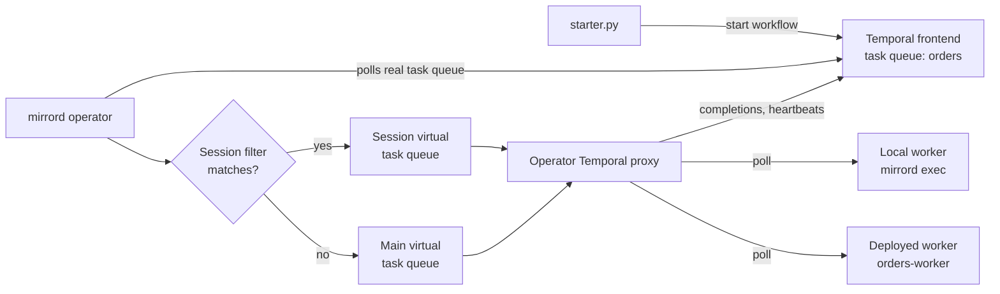

# How to Test Temporal Workers in Kubernetes with Queue Splitting

A Temporal worker in a shared staging cluster polls one task queue. If you run a second copy of the worker on your laptop, it competes with the deployed worker for tasks. You cannot control which workflows your copy gets.

mirrord queue splitting solves this problem. The mirrord operator reads the real task queue and sends each task to the correct worker. Tasks that match your filter go to your local worker. All other tasks go to the deployed worker. The worker code needs no routing logic: no SDK, no interceptors, and no filter checks in your code.

In this tutorial, you deploy a small Temporal setup and a Python worker. Then you run the same worker on your laptop with mirrord and start workflows with different workflow IDs. You see which worker processes each workflow.

**Estimated time:** 20 minutes.

## How Temporal changes the isolation problem

Temporal is not a message broker. A worker does not read messages. It polls a task queue on the Temporal frontend, and the server gives each task to exactly one poll. Thus, a copy of a message for each consumer is not possible. A task goes to one worker only.

Temporal has no native way to split a task queue. The mirrord operator adds a small gRPC proxy and a set of virtual task queues to do this. The deployed worker and your local worker each poll their own virtual task queue through the proxy. The operator polls the real task queue and puts each task on the correct virtual queue.

Temporal queue splitting supports `steal` only. A task that matches your filter goes to your local worker, and the deployed worker does not see it.

## What you will deploy

All resources go into one namespace, `temporal-demo`:

| Resource | Purpose |
| --- | --- |
| `temporal-postgres` Deployment and Service | The database for the Temporal dev server. |
| `temporal` Deployment and `temporal-frontend` Service | A single-replica Temporal server (`temporalio/auto-setup`). It creates the `default` Temporal namespace. |
| `orders-worker-code` ConfigMap | The Python worker script. No image build is necessary. |
| `orders-worker` Deployment | The deployed worker. It polls the task queue `orders`. |
| `temporal-config` `MirrordPropertyList` | The connection that the operator uses to poll the real task queue. |
| `orders-worker-split` `MirrordSplitConfig` | Tells the operator how the worker finds its task queue, its Temporal address, and its Temporal namespace. |

On your laptop, you use two scripts: `worker.py` (the same worker code) and `starter.py` (it starts workflows).

## Prerequisites

* A Kubernetes cluster, version `1.30` or later. Queue splitting needs this version.
* `kubectl`, with access to the cluster.
* `helm`.
* Python 3.9 or later on your laptop. <!-- TODO: confirm the minimum Python version that the current temporalio release supports. -->
* The mirrord CLI, version `3.221.0` or later.
* The mirrord operator, version `3.170.0` or later, with a mirrord for Teams license. The operator must have the `operator.temporalSplitting` Helm value set to `true`.

<!-- TODO: confirm with the INT team. In operator source, the fix that lets sdk-core workers (Python, TypeScript, .NET) schedule activities on a split task queue is first in tag 3.198.0, and gzip support for Python workers is first in tag 3.205.0. If this is correct, give 3.205.0 as the minimum for this Python tutorial. -->

To install or upgrade the operator with Temporal splitting, run this command. Replace `<LICENSE_KEY>` with your license key.

```bash
helm repo add metalbear https://metalbear-co.github.io/charts
helm upgrade --install mirrord-operator metalbear/mirrord-operator \
  --set license.key=<LICENSE_KEY> \
  --set operator.temporalSplitting=true
```

When this value is `true`, the operator runs a Temporal proxy. The deployed worker connects to this proxy during a split. The proxy port is `7233` by default. To change it, set the `operator.temporalProxy.port` Helm value.

Make sure that the `MirrordSplitConfig` CRD is in the cluster:

```bash
kubectl get crd mirrordsplitconfigs.queues.mirrord.metalbear.co
```

Install the Temporal Python SDK on your laptop:

```bash
python3 -m pip install temporalio
```

## Deploy the demo

### Step 1: Deploy Temporal

Save this manifest as `temporal.yaml`. It runs a Temporal server with a Postgres database. Use these dev settings in a demo cluster only.

```yaml
apiVersion: v1
kind: Namespace
metadata:
  name: temporal-demo
---
apiVersion: apps/v1
kind: Deployment
metadata:
  name: temporal-postgres
  namespace: temporal-demo
spec:
  replicas: 1
  selector:
    matchLabels:
      app: temporal-postgres
  template:
    metadata:
      labels:
        app: temporal-postgres
    spec:
      containers:
        - name: postgres
          image: postgres:15-alpine
          env:
            - name: POSTGRES_USER
              value: temporal
            - name: POSTGRES_PASSWORD
              value: temporal
          ports:
            - containerPort: 5432
          readinessProbe:
            exec:
              command: ["pg_isready", "-U", "temporal"]
            initialDelaySeconds: 5
            periodSeconds: 5
---
apiVersion: v1
kind: Service
metadata:
  name: temporal-postgres
  namespace: temporal-demo
spec:
  selector:
    app: temporal-postgres
  ports:
    - port: 5432
      targetPort: 5432
---
apiVersion: apps/v1
kind: Deployment
metadata:
  name: temporal
  namespace: temporal-demo
spec:
  replicas: 1
  selector:
    matchLabels:
      app: temporal
  template:
    metadata:
      labels:
        app: temporal
    spec:
      initContainers:
        - name: wait-for-postgres
          image: busybox:1.36
          command:
            - sh
            - -c
            - until nc -z temporal-postgres 5432; do sleep 2; done
      containers:
        - name: temporal
          image: temporalio/auto-setup:1.24.2
          env:
            - name: DB
              value: postgres12
            - name: DB_PORT
              value: "5432"
            - name: POSTGRES_USER
              value: temporal
            - name: POSTGRES_PWD
              value: temporal
            - name: POSTGRES_SEEDS
              value: temporal-postgres
            - name: POD_IP
              valueFrom:
                fieldRef:
                  fieldPath: status.podIP
            - name: BIND_ON_IP
              value: "0.0.0.0"
            - name: TEMPORAL_BROADCAST_ADDRESS
              value: "$(POD_IP)"
          ports:
            - containerPort: 7233
              name: frontend
          readinessProbe:
            tcpSocket:
              port: 7233
            initialDelaySeconds: 45
            periodSeconds: 5
---
apiVersion: v1
kind: Service
metadata:
  name: temporal-frontend
  namespace: temporal-demo
spec:
  selector:
    app: temporal
  ports:
    - port: 7233
      targetPort: 7233
      name: frontend
```

Apply the manifest and wait for the server:

```bash
kubectl apply -f temporal.yaml
kubectl -n temporal-demo rollout status deployment/temporal --timeout=5m
```

### Step 2: Write the worker

Save this script as `worker.py`. The worker reads its Temporal address, Temporal namespace, and task queue from environment variables. The activity prints the workflow ID and the customer field, so you can see which worker gets each workflow.

```python
import asyncio
import os
from datetime import timedelta

import temporalio.service
from temporalio import activity, workflow
from temporalio.client import Client
from temporalio.worker import Worker


@activity.defn
async def process_order(customer: str) -> str:
    info = activity.info()
    print(f"processed workflow_id={info.workflow_id} customer={customer}", flush=True)
    return f"done:{customer}"


@workflow.defn
class OrderWorkflow:
    @workflow.run
    async def run(self, customer: str) -> str:
        return await workflow.execute_activity(
            process_order, customer, start_to_close_timeout=timedelta(seconds=30)
        )


async def main() -> None:
    address = os.environ["TEMPORAL_ADDRESS"]
    namespace = os.environ["TEMPORAL_NAMESPACE"]
    task_queue = os.environ["TEMPORAL_TASK_QUEUE"]

    # The operator's Temporal proxy does not support gRPC compression.
    # SDK releases that have GrpcCompression use gzip by default, so turn it off.
    options = {}
    compression = getattr(temporalio.service, "GrpcCompression", None)
    if compression is not None:
        options["grpc_compression"] = compression.NONE

    client = await Client.connect(address, namespace=namespace, **options)
    print(f"polling task_queue={task_queue} address={address}", flush=True)
    worker = Worker(
        client,
        task_queue=task_queue,
        workflows=[OrderWorkflow],
        activities=[process_order],
    )
    await worker.run()


if __name__ == "__main__":
    asyncio.run(main())
```


The worker must read the task queue name from an environment variable or from a mounted config file. The operator changes this value to point the worker at a virtual task queue. A task queue name that is fixed in the code cannot be split.


### Step 3: Deploy the worker

Put the script in a ConfigMap:

```bash
kubectl -n temporal-demo create configmap orders-worker-code --from-file=worker.py
```

Save this manifest as `worker.yaml`. The Deployment uses a public Python image and installs the SDK when the pod starts. Define the three environment variables directly in the pod template. The operator can read environment variables only from the pod template (`value`, or `valueFrom` with a ConfigMap reference) or from ConfigMaps loaded with `envFrom`.

```yaml
apiVersion: apps/v1
kind: Deployment
metadata:
  name: orders-worker
  namespace: temporal-demo
spec:
  replicas: 1
  selector:
    matchLabels:
      app: orders-worker
  template:
    metadata:
      labels:
        app: orders-worker
    spec:
      containers:
        - name: worker
          image: python:3.12-slim
          command:
            - sh
            - -c
            - pip install --quiet temporalio && python -u /app/worker.py
          env:
            - name: TEMPORAL_ADDRESS
              value: temporal-frontend.temporal-demo.svc.cluster.local:7233
            - name: TEMPORAL_NAMESPACE
              value: default
            - name: TEMPORAL_TASK_QUEUE
              value: orders
          volumeMounts:
            - name: code
              mountPath: /app
      volumes:
        - name: code
          configMap:
            name: orders-worker-code
```

Apply the manifest:

```bash
kubectl apply -f worker.yaml
kubectl -n temporal-demo rollout status deployment/orders-worker
```

If the worker starts before the server creates the `default` Temporal namespace, the pod can restart one time. This is normal.

### Step 4: Create the mirrord resources

Save this manifest as `split.yaml`:

```yaml
apiVersion: mirrord.metalbear.co/v1
kind: MirrordPropertyList
metadata:
  name: temporal-config
  namespace: temporal-demo
spec:
  properties:
    - name: address
      value: temporal-frontend.temporal-demo.svc.cluster.local:7233
    - name: namespace
      value: default
---
apiVersion: queues.mirrord.metalbear.co/v1
kind: MirrordSplitConfig
metadata:
  name: orders-worker-split
  namespace: temporal-demo
spec:
  targetRef:
    apiVersion: apps/v1
    kind: Deployment
    name: orders-worker
  clientConfigs:
    temporal: temporal-config
  queues:
    - id: orders
      kind: temporal
      appConfig:
        taskQueue:
          - env: TEMPORAL_TASK_QUEUE
        temporalAddress:
          - env: TEMPORAL_ADDRESS
        temporalNamespace:
          - env: TEMPORAL_NAMESPACE
```

The `MirrordPropertyList` gives the operator the address of the real Temporal frontend and the Temporal namespace to poll. The `MirrordSplitConfig` tells the operator these facts about the `orders-worker` Deployment:

* The worker reads its task queue name from `TEMPORAL_TASK_QUEUE`. The operator changes this value to a virtual task queue.
* The worker reads the frontend address from `TEMPORAL_ADDRESS`. The operator changes this value to the address of its Temporal proxy.
* The worker reads the Temporal namespace from `TEMPORAL_NAMESPACE`.
* Developers refer to this task queue with the ID `orders` in `mirrord.json`.

Apply the manifest:

```bash
kubectl apply -f split.yaml
```

### Step 5: Write the starter

Save this script as `starter.py`. It starts one `OrderWorkflow` for each workflow ID that you give. The first part of the workflow ID is the customer, so `alice-order-1` belongs to `alice`.

```python
import asyncio
import os
import sys

from temporalio.client import Client


async def main() -> None:
    address = os.environ.get("TEMPORAL_ADDRESS", "localhost:7233")
    client = await Client.connect(address, namespace="default")
    for workflow_id in sys.argv[1:]:
        customer = workflow_id.split("-")[0]
        await client.start_workflow(
            "OrderWorkflow", customer, id=workflow_id, task_queue="orders"
        )
        print(f"started workflow_id={workflow_id}")


if __name__ == "__main__":
    asyncio.run(main())
```

The starter always uses the real task queue, `orders`. Do not start workflows on a virtual task queue. Only the operator serves virtual task queues.

The starter connects to the Temporal frontend through a port-forward. Open a terminal and keep this command open:

```bash
kubectl -n temporal-demo port-forward svc/temporal-frontend 7233:7233
```

## Confirm the baseline

Before you start a mirrord session, make sure that the deployed worker gets all workflows. In a new terminal, start three workflows:

```bash
python3 starter.py alice-order-1 bob-order-1 carol-order-1
```

Look at the logs of the deployed worker:

```bash
kubectl -n temporal-demo logs deployment/orders-worker --tail=5
```

The deployed worker processes all three workflows:

```
processed workflow_id=alice-order-1 customer=alice
processed workflow_id=bob-order-1 customer=bob
processed workflow_id=carol-order-1 customer=carol
```

## Create sessions and test

### Step 1: Write the mirrord configuration

Alice wants to get only her own workflows. Save this file as `mirrord-alice.json`:

```json
{
  "operator": true,
  "target": {
    "path": "deployment/orders-worker",
    "namespace": "temporal-demo"
  },
  "feature": {
    "split_queues": {
      "orders": {
        "queue_type": "Temporal",
        "message_filter": {
          "workflow_id": "^alice-"
        }
      }
    }
  }
}
```

The key under `split_queues` (`orders`) is the queue ID from the `MirrordSplitConfig`. The value of `queue_type` must be `Temporal`. The filter is a regex on the workflow ID. Only workflows whose IDs start with `alice-` go to the local worker.

### Step 2: Run the worker locally

Open a new terminal. Run the same `worker.py` with mirrord:

```bash
mirrord exec -f mirrord-alice.json -- python3 worker.py
```

You do not set any environment variables on your laptop. mirrord gives the local worker the environment of the target. The operator replaces the task queue with the session virtual task queue, and the address with its Temporal proxy.

When the session starts, the operator patches the deployed worker to poll the main virtual task queue through the proxy. The deployed worker pod restarts. Wait until the local worker prints a `polling` line.

### Step 3: Start matching and non-matching workflows

In the starter terminal, start three new workflows:

```bash
python3 starter.py alice-order-2 bob-order-2 carol-order-2
```

The local worker terminal shows only the workflow for Alice:

```
processed workflow_id=alice-order-2 customer=alice
```

Look at the logs of the deployed worker:

```bash
kubectl -n temporal-demo logs deployment/orders-worker --tail=5
```

The deployed worker gets the other two workflows:

```
processed workflow_id=bob-order-2 customer=bob
processed workflow_id=carol-order-2 customer=carol
```

The worker code is the same in both places. Change `worker.py` on your laptop, for example the text in the `print` call, and run the `mirrord exec` command again. Only your workflows go to the changed code.

### Step 4: Add a second developer

Many developers can split the same task queue at the same time. Each session gets its own session virtual task queue. Save this file as `mirrord-bob.json`:

```json
{
  "operator": true,
  "target": {
    "path": "deployment/orders-worker",
    "namespace": "temporal-demo"
  },
  "feature": {
    "split_queues": {
      "orders": {
        "queue_type": "Temporal",
        "message_filter": {
          "workflow_id": "^bob-"
        }
      }
    }
  }
}
```

Keep the session for Alice open. In a new terminal, start a session for Bob:

```bash
mirrord exec -f mirrord-bob.json -- python3 worker.py
```

Start three more workflows:

```bash
python3 starter.py alice-order-3 bob-order-3 carol-order-3
```

The result:

| Workflow ID | Worker that processes it |
| --- | --- |
| `alice-order-3` | Alice's local worker |
| `bob-order-3` | Bob's local worker |
| `carol-order-3` | The deployed worker |

If the filters of two sessions match the same task, only one session gets it. The task goes to the session that started most recently. To prevent this, use filters that do not overlap.

### Step 5: Stop a session

Press `Ctrl+C` in the terminal of Bob's local worker. The `bob-` workflows that you start after this go to the deployed worker again, because no session filter matches them.

If a session ends while the operator holds buffered tasks for it, these tasks go to the main virtual task queue. The deployed worker processes them, so the operator does not lose them.

Press `Ctrl+C` in the terminal of Alice's local worker. After the last session ends, the operator keeps the split resources for the drain timeout, and then removes them. The drain timeout is `0` by default, so the operator removes them immediately. The operator does not wait for in-flight work to finish. To keep the split resources for a time, set `spec.drainTimeout` (in seconds) on the `MirrordSplitConfig`. A new session in that time uses the same resources.

<!-- TODO: confirm that the deployed worker pod restarts again with the original TEMPORAL_ADDRESS and TEMPORAL_TASK_QUEUE values when the split is torn down. The reference page does not say this directly. -->

## How it works

When the first session starts, the operator polls the real task queue and keeps the tasks in memory. It patches the deployed worker to poll the main virtual task queue through the operator's Temporal proxy. For each task, the operator applies the filter of each session. A task that matches a filter goes to the virtual task queue of that session. All other tasks go to the main virtual task queue. The proxy serves polls for the virtual task queues from the buffered tasks, and sends all other calls (task completions, heartbeats) to the real frontend with no change.



## Behavior and tradeoffs

* **Steal only.** Temporal gives each task to exactly one worker poll. Temporal queue splitting supports `steal` only. If you set `queue_mode: mirror` on a Temporal queue, or use `mirrord up` in mirror mode, the session runs as `steal`. mirrord prints a warning for each Temporal queue when this occurs.
* **What the filter can match.** `message_filter` applies regexes to task metadata. The supported keys are:
  * `workflow_id`: the workflow ID.
  * `workflow_type`: the workflow type name.
  * `activity_type`: the activity type name.
  * `header.<name>`: the value of a Temporal header, for example `header.x-user`.
  * Any other key: the value of the [search attribute](https://docs.temporal.io/visibility#search-attribute) with that name.

  When you give more than one key, all of them must match.
* **jq filters.** `jq_filter` runs on a JSON document that the operator makes for each task. Each document has a `task_type` field, with the value `"activity"` or `"workflow"`. An activity task document has `workflow_namespace`, `workflow_id`, `run_id`, `workflow_type`, `activity_type`, `activity_id`, `attempt`, `header`, and `input`. A workflow task document has `workflow_id`, `run_id`, `workflow_type`, `attempt`, `task_queue`, `cron_schedule`, `identity`, `first_execution_run_id`, `header`, `search_attributes`, `memo`, and `input`. The `input` field is an array of decoded payloads. If you set `message_filter` and `jq_filter` on the same queue, both must match.
* **Workflow tasks and activity tasks.** The operator applies the filter to each task, not to each workflow. A `workflow_id` filter matches the workflow tasks and the activity tasks of a workflow, because both carry the workflow ID. An `activity_type` filter can match an activity task, but not the workflow tasks of the same workflow.
* **Buffer size.** The operator keeps buffered tasks in memory. By default, the buffer has no limit. To set a limit, add the `max_buffered_tasks` property to a `MirrordPropertyList`, and refer to it with `queueConfig` on the queue entry. When a session queue reaches the limit, its tasks go to the main virtual task queue.
* **Overlapping filters.** When two session filters match one task, the session that started most recently gets the task.
* **gRPC compression.** The operator's Temporal proxy does not support gRPC compression. Python `temporalio` releases use gzip by default, which fails with `grpc compression not supported`. The worker in this tutorial turns compression off with `grpc_compression=GrpcCompression.NONE`.
* **TLS.** TLS applies to the connection between the operator and the Temporal frontend. Deployed workers in a split connect to the operator's proxy over plaintext gRPC.
* **KEDA.** KEDA cannot measure a task queue that the operator serves. If KEDA scales the worker, the operator pauses KEDA at one replica while the split runs. This needs the `operator.manageKedaScaledObjects` Helm value.
* **Supported workloads.** The target can be a `Deployment`, a `StatefulSet`, or an Argo `Rollout`.

## Adapt this to your stack

To use queue splitting with a real worker, change these items:

1. **Target.** Set `spec.targetRef` in the `MirrordSplitConfig` and `target` in `mirrord.json` to your worker workload. To use one config for many workloads with the same labels, use `targetSelector` instead of `targetRef`.
2. **Task queue source.** Point `appConfig.taskQueue` at the environment variable that holds your task queue name. If the name is in a config file from a ConfigMap or Secret volume, use a `volume` source with `valueSelector`. If your worker uses other variable names for the address and the namespace, change `temporalAddress` and `temporalNamespace` to match.
3. **Connection and auth.** Set `address` and `namespace` in the `MirrordPropertyList` to your Temporal frontend. For a frontend behind TLS, set `tls: "true"`. For Temporal Cloud, add `apiKey` from a Secret. For a private CA, add `tlsCaCert`. For mutual TLS, add `tlsClientCert` and `tlsClientKey`. Keep certificate material in a Secret and refer to it with `secretKeyRef`.
4. **Filter field.** Use a field that your workflows already carry. A workflow ID prefix is the easiest choice, because the code that starts the workflow sets it. To filter on a value that moves through many services, use a Temporal header such as `header.baggage`. See [Header Propagation](../../sharing-the-cluster/header-propagation.md).
5. **Queue ID.** Use the same `id` in the `MirrordSplitConfig` and as the key under `feature.split_queues`.

The routing logic of your worker does not change. The worker continues to read its task queue and address from its environment, and the operator changes these values. The only change in this tutorial's worker is the connection option that turns off gRPC compression.

<!-- TODO: operator source (tag 3.205.0 and later) decompresses gzip frames from Python workers, but the reference page still says that compression is not supported. Confirm which is current. If gzip works, remove the compression code from worker.py and change the "gRPC compression" item and this paragraph. -->

## Cleanup

Stop all `mirrord exec` sessions and the port-forward with `Ctrl+C`. Then delete the demo namespace:

```bash
kubectl delete namespace temporal-demo
```

This command deletes the Temporal server, the worker, and the mirrord resources. To turn off Temporal splitting in the operator, run the Helm upgrade again with `operator.temporalSplitting=false`.

## Frequently asked questions

### Do I need to change my Temporal worker code to use queue splitting?

No routing logic is necessary. The worker must read its task queue name and frontend address from environment variables or from a mounted config file, so that the operator can change them. Python workers must turn off gRPC compression, as the reference page says.

### Can my local Temporal worker and the deployed worker both process the same workflow?

No. Temporal gives each task to exactly one worker poll. Temporal queue splitting supports `steal` only. A matching task goes to your local worker, and the deployed worker does not see it.

### How do I filter Temporal workflows by workflow ID, header, or search attribute?

Use `message_filter` in `feature.split_queues`. The keys are `workflow_id`, `workflow_type`, `activity_type`, `header.<name>` for a Temporal header, and any other key for a search attribute. Each value is a regex. For filters on the workflow input, use `jq_filter`.

### Can several developers test Temporal workers on the same task queue at the same time?

Yes. Each session gets its own session virtual task queue. Give each developer a filter that does not overlap with the others. If two filters match one task, the session that started most recently gets it.

### What happens to Temporal tasks when I stop my mirrord session?

Tasks that the operator buffered for your session go to the main virtual task queue, and the deployed worker processes them. After the last session ends, the operator removes the split resources after the drain timeout. The operator does not wait for in-flight work.

### Does Temporal queue splitting work with Temporal Cloud?

Yes. Set `tls: "true"` and an `apiKey` from a Secret in the `MirrordPropertyList`. For mTLS authentication, set `tlsClientCert` and `tlsClientKey` instead.

## See also

* [Temporal queue splitting reference](../../sharing-the-cluster/queue-splitting/temporal.md)
* [Queue splitting overview](../../sharing-the-cluster/queue-splitting.md)
* [Setting a filter for a mirrord run](../../sharing-the-cluster/queue-splitting.md#setting-a-filter-for-a-mirrord-run)
* [`feature.split_queues` configuration option](https://metalbear.com/mirrord/docs/config/options#feature-split_queues)
* [Header Propagation](../../sharing-the-cluster/header-propagation.md)
